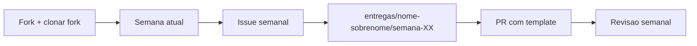
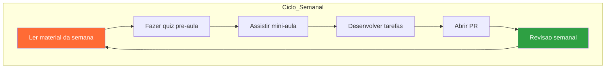

# Guia do Aluno

Este guia explica o fluxo do treinamento e o que se espera de cada entrega.

## Como funciona

1. Faça fork do repositório e clone o seu fork (você trabalha na `main` do fork)
2. Leia a semana atual e a issue semanal correspondente
3. Desenvolva dentro de `entregas/<nome-sobrenome>/semana-XX/` (veja o [Padrão de Entregas](padrao-entregas.md))
4. Abra PR do seu fork para a `main` original usando o template
5. Participe da revisão semanal; depois do merge, sincronize o fork e siga para a próxima semana

> Regra de ouro: **nunca apague o material do repositório** — você só adiciona arquivos na sua pasta em `entregas/`.

## Fluxo do Treinamento

## Progressão das Semanas

## O que você deve entregar

- Código funcional
- README com instruções
- Evidências (logs/prints simples)

## Onde encontrar tudo

- Roadmap: [roadmap](roadmap.md)
- Entregas: [Padrão de Entregas](padrao-entregas.md)
- Semanas: [Semanas do Treinamento](semanas/README.md)
- Issues semanais: [Issues Semanais (Exemplos)](issues-semanais/README.md)
- Trilhas: [Trilhas de Conteudo](trilhas/README.md)
- Exemplos: [Exemplos Minimos](examples/README.md)
- Exemplos Visuais: [Guia Visual](exemplos-visuais.md)
- Status: [Progresso dos trainees](status.md)

## Dicas

- Foque no essencial
- Documente o mínimo para reprodução
- Pergunte cedo se travar

## 💻 Nota sobre o sistema operacional

Todo o treinamento foi desenvolvido e testado em Linux. Os comandos, paths (`/dev/ttyACM0`, `~/.bashrc`) e instruções de permissão refletem esse ambiente.

Se você usa Windows, algumas adaptações são necessárias:
- Porta serial: `COM3`, `COM4` etc. (em vez de `/dev/ttyACM0`)
- Git: use Git Bash ou WSL para comandos no terminal
- Python: certifique-se de que `python` (ou `py`) está no PATH
- PlatformIO: funciona normalmente via VSCode. A porta de upload é detectada automaticamente
- Drivers: ESP32-C3 pode precisar de driver CP2102 ou CH340 no Windows

Quando encontrar algo que não funciona igual, pesquise `"<comando> windows"` ou pergunte na issue da semana.
