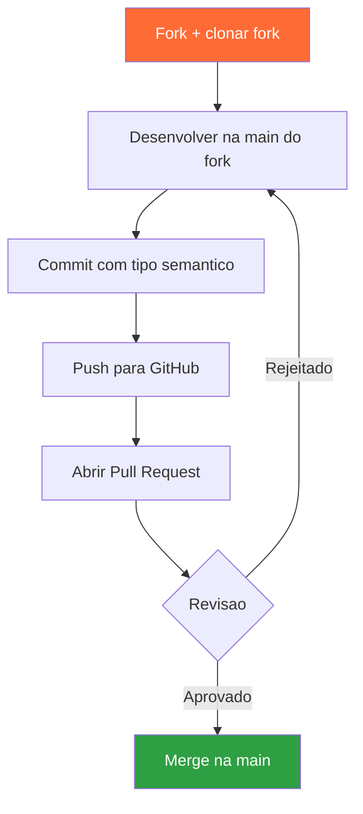
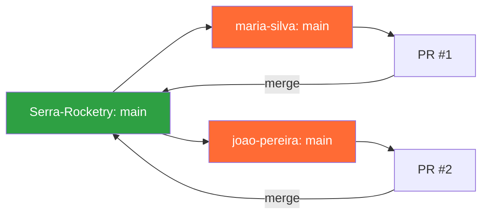

# Trilha GitHub

GitHub é a plataforma central do treinamento e dos projetos da Serra Rocketry. Todo o fluxo de trabalho - desde issues até PRs e revisões - é feito aqui. Os repositórios Helike e Flight Computer também seguem este mesmo fluxo.

## O que você vai aprender

- Git básico (fork, clone, add, commit, push, pull)
- Trabalhar no fork e manter sincronizado com o repositório original
- Criar issues com critérios claros
- Abrir e revisar Pull Requests
- Colaborar usando o fluxo do GitHub

## Fluxo de Trabalho com Git



## Estrutura de Repositórios



---

## 1. Git básico

### 1.1 Configuração inicial

```bash
git config --global user.name "Seu Nome"
git config --global user.email "seu@email.com"
```

### 1.2 Comandos essenciais

```bash
# Clonar o SEU fork (veja o passo a passo de fork no Padrão de Entregas)
git clone https://github.com/<seu-usuario>/telemetry-trainee-program.git
cd telemetry-trainee-program

# Registrar o repositório original para sincronizar
git remote add upstream https://github.com/Serra-Rocketry/telemetry-trainee-program.git

# Ver status das alterações
git status

# Adicionar arquivos ao staging
git add arquivo.py
git add .  # adiciona tudo

# Commitar
git commit -m "descrição curta e objetiva do que foi feito"

# Enviar para o GitHub
git push origin main

# Atualizar sua cópia local com a main do repositório original
git pull upstream main
```

### 1.3 Mensagens de commit

Commit messages são fundamentais para entender cada mudança.  
Pergunte-se: "Por que essa alteração foi feita?" - a resposta é o que não está óbvio no diff do código.

Formato:

```
<tipo>: <descrição concisa no presente>
```

Regras:
- Presente imperativo: "Adiciona parser" em vez de "Adicionei parser"
- Curta e objetiva (máximo 72 caracteres no título)
- Explique o motivo, não só o que foi mudado
- Commits atômicos: cada commit faz uma única alteração lógica

#### Tipos semânticos

| Tipo | Quando usar |
|---|---|
| `feat` | Novo recurso ou funcionalidade |
| `fix` | Correção de bug |
| `docs` | Mudanças em documentação (README, comentários) |
| `test` | Alterações em testes unitários |
| `build` | Mudanças em build, dependências, CI |
| `perf` | Melhorias de performance |
| `style` | Formatação, lint, espaços - sem mudança lógica |
| `refactor` | Refatoração sem mudança de comportamento |
| `chore` | Tarefas administrativas, gitignore, config |
| `ci` | Integração contínua (GitHub Actions) |
| `raw` | Dados, configurações, parâmetros |
| `cleanup` | Remoção de código comentado ou morto |
| `remove` | Exclusão de arquivos ou funcionalidades |

Exemplos bons:
```
feat: adiciona parser de pacote de telemetria
fix: valida altitude negativa antes do cálculo da média
docs: atualiza README com instruções de setup
test: adiciona teste para detecção de apogeu
refactor: extrai validação de dados para módulo separado
```

Exemplos ruins:
```
Update
fix
varios ajustes
teste
```

---

## 2. Fork e sincronização

Você trabalha na branch `main` do **seu fork** - não é preciso criar uma branch pessoal:

```
Serra-Rocketry/telemetry-trainee-program (original, upstream)
 └── <seu-usuario>/telemetry-trainee-program (seu fork) -> main
```

```bash
# Enviar seus commits para o seu fork
git push origin main

# Manter a main do seu fork atualizada com o repositório original
git checkout main
git pull upstream main
git push origin main
```

> Regra: você só escreve dentro de `entregas/<seu-nome-sobrenome>/`. Nunca edite o material do repositório.

As entregas ficam em `entregas/<seu-nome-sobrenome>/semana-XX/` — veja o [Padrão de Entregas](../padrao-entregas.md).

---

## 3. Issues

Issues são usadas para descrever tarefas, bugs ou melhorias. Cada semana de treinamento tem uma issue associada.

### 3.1 Estrutura de uma issue

```
## Objetivo
<descrição clara do que precisa ser feito>

## Tarefas
- [ ] tarefa 1
- [ ] tarefa 2
- [ ] tarefa 3

## Critérios de aceite
- [ ] critério 1
- [ ] critério 2

## Referências
- Link para trilha
- Link para exemplo
```

### 3.2 Boas práticas

- Título claro: `Semana 1 - Leitura de CSV de telemetria`
- Use checklists para tarefas e critérios de aceite
- Atribua a si mesmo (assignee)
- Adicione labels: `semana-1`, `python`, `trainee`
- Consulte as [issues semanais de exemplo](../issues-semanais/)

Exemplo real - Os repositórios Helike e Flight Computer usam issues para planejar sprints, com labels como `firmware`, `hardware`, `test`, e milestones por fase.

---

## 4. Pull Requests

O PR é o mecanismo de entrega do treinamento. Toda semana você abre um PR da `main` do seu fork para a `main` do repositório original.

### 4.1 Abrindo um PR

1. Faça suas alterações na sua pasta `entregas/seu-nome-sobrenome/semana-XX/`
2. Commit e push para o seu fork (`git push origin main`)
3. No GitHub, abra o PR da sua `main` para a `main` do repositório original ("Compare across forks")
4. Preencha o [template de PR](../../templates/pr-template.md)
5. Solicite revisão

### 4.2 Template de PR

```markdown
## Semana X - <título da semana>

## O que foi feito
- [ ] tarefa 1
- [ ] tarefa 2

## Como testar
1. Comandos para executar
2. Saída esperada

## Critérios de aceite
- [ ] código executa sem erros
- [ ] README atualizado

## Dificuldades
- O que travou? Como resolveu?
```

### 4.3 Revisão de PR

Na revisão semanal, o instrutor (ou um colega) vai revisar seu código:

1. Leia o código - entenda o que foi feito
2. Teste localmente - baixe o fork e execute
3. Comente - aponte sugestões e perguntas
4. Aprove ou peça mudanças

> Revisão não é fiscalização - é mentoria. O objetivo é todo mundo aprender.

---

## 5. Fluxo completo do treinamento

```
1. Instrutor abre issue da semana
2. Trainee lê a issue e a trilha correspondente
3. Trainee faz fork e clona o fork (uma vez só)
4. Trainee cria a pasta entregas/nome-sobrenome/semana-XX/ e faz as tarefas
5. Trainee faz commit e push na main do fork
6. Trainee abre PR do fork para a main, usando o template
7. Instrutor revisa no encontro semanal
8. PR é aprovado e mergeado
9. Na próxima semana, trainee sincroniza o fork e abre uma nova PR 🚀
```

---

## 6. GitHub Projects (Kanban)

Os projetos podem usar Projects para acompanhar o progresso:

- Backlog - issues a fazer
- Em andamento - issues sendo trabalhadas
- Em revisão - PRs abertos aguardando review
- Concluído - PRs mergeados

---

## Exercícios práticos

### Nível 1 - Setup

1. Crie sua conta GitHub (se não tiver).
2. Configure git local (nome, email).
3. Faça um **fork** do repositório e clone o seu fork.

### Nível 2 - Primeira entrega

1. Crie a pasta `entregas/seu-nome-sobrenome/semana-00/`.
2. Adicione dois arquivos: um `README.md` (na pasta pessoal, com seu nome e objetivos) e um `hello.py` (na pasta da semana).
3. Commit com mensagem descritiva.
4. Push para a `main` do seu fork.
5. Abra um PR para `main` usando o template.

### Nível 3 - Colaboração

1. Revise o PR de um colega.
2. Deixe pelo menos um comentário construtivo.
3. Responda aos comentários no seu próprio PR.
4. Faça as alterações solicitadas e dê push.

### Nível 4 - Resolução de conflitos

1. Simule um conflito: duas pessoas editam a mesma linha em pontos diferentes.
2. Resolva o conflito no PR (resolve no GitHub ou localmente).
3. Complete o merge.

---

## Entregas relacionadas

- [Semana 0](../semanas/semana-00.md): fork, setup + estrutura `entregas/` + PR "hello world"
- Todas as semanas: PR com entrega em `entregas/<nome-sobrenome>/semana-XX/`

## Critérios de aceite

- Fork criado na sua conta
- Entrega em `entregas/nome-sobrenome/semana-XX/` (sem apagar o material do repo)
- PR da `main` do fork para a `main` original
- PR segue o template
- README da semana com instruções
- Commits com mensagens claras
- Participou da revisão de PR
